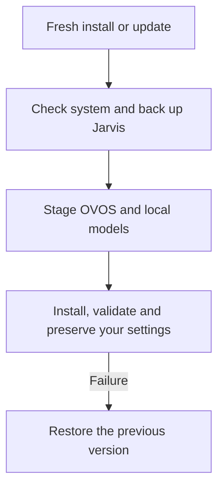

# Jarvis · Voice control for Linux Mint

Jarvis lets you control your Linux desktop by voice. Standard commands run
first. Optional local AI helps with varied wording and can use only the
actions and apps you have enabled.

## Why Jarvis

- **Local by default.** Wake word, speech recognition, routing and speech
  output run on your machine.
- **Simple commands.** Say “open notes”, “search Firefox” or “play Get Lucky”.
- **Personal.** Choose the apps behind Browser, Notes, Mail, Calendar and
  Office, add spoken names and keep your own commands.
- **Recoverable.** Updates check changes, preserve your settings and keep a
  rollback copy.
- **Visible.** One tray icon and a Light/Dark Control Centre show services,
  microphone, updates and private session activity.

## Get started

### Before you install

- Use **Linux Mint 22.x, X11 and x86_64**, with a working microphone and speakers.
  Mint 22.3 is the tested desktop target. See [Requirements and stack](#requirements-and-stack).
- Setup prepares its own **Python 3.11.16** when needed. System Python stays
  unchanged. See [Python setup](docs/07-installer-updates.md#preparing-python)
  if you already have an OVOS environment using another Python version.
- Keep at least **8 GiB free** for installation and rollback, plus room for
  voice and AI models. Check the filesystem holding Ollama's model storage;
  free space in your home directory may not cover those downloads.
- Install and start **Ollama** using its [Linux setup guide](https://docs.ollama.com/linux).
  Jarvis reuses an existing installation; it does not install Ollama.
- Internet access is needed for initial downloads. Optional isolation is
  applied afterwards and leaves your general Ollama instance unchanged.
- Run setup **without sudo**. It asks for administrator approval only when
  needed for system prerequisites or isolation.

For a **new installation**, run these prerequisites as your desktop user.
Ollama installation and service startup may request administrator approval.
Existing users should follow the [upgrade procedure](docs/07-installer-updates.md#upgrading-an-isolated-installation).

**Prepare Ollama and Jarvis's model.** Install Ollama only if it is missing:

```bash
(
  set -euo pipefail
  if ! command -v ollama >/dev/null 2>&1; then
    curl --proto '=https' --tlsv1.2 -LsSf https://ollama.com/install.sh | sh
  fi
  sudo systemctl start ollama
  OLLAMA_HOST=http://127.0.0.1:11434 \
    ollama pull qwen3:4b-instruct-2507-q4_K_M
)
```

Continue after the model download succeeds. Jarvis reuses it and sets up Python
automatically. If the download reports an IPv6 connection refusal while using
a VPN, check the VPN's IPv6 tunnel setting and retry.
See [model download and storage](docs/troubleshooting.md#model-download-and-storage).

For optional reading and dictation, install **Speech Note** through Software
Manager. In Speech Note, choose a TTS voice and enable **Settings → Accessibility
→ Allow external applications to invoke actions**. Jarvis reuses an existing
user or system Flatpak; see its Voice setup guide.

### Install Jarvis

Download the archive and matching `.sha256` from
[Releases](https://github.com/evok3dx/OVOS-Commands/releases/latest):

```bash
version=4.9.0
sha256sum --check "ovos-commands-$version.tar.gz.sha256"
tar -xzf "ovos-commands-$version.tar.gz"
cd "ovos-commands-$version"
bash scripts/install.sh
```

Setup checks prerequisites, installs OVOS and offers network isolation.
Isolation is recommended and needs administrator approval. Existing isolation
choices are preserved. Reading and dictation use optional Speech Note.

For a read-only preflight, run `bash scripts/install.sh --check`.
For Jarvis **4.5 or later**, update through **Updates** in the Control Centre.
See the [installation and upgrade guide](docs/07-installer-updates.md) for details.



## Requirements and stack

The tested target is **Linux Mint 22.3 on X11, x86_64**. Wayland is not supported.
Isolation needs Mint 22.x's supported Polkit and systemd network filtering.
Setup checks compatibility and prepares its own Python 3.11.16 environment.
Exact package versions and hashes are listed in
[`compatibility.json`](compatibility.json) and
[`voice/reviewed-stack.json`](voice/reviewed-stack.json).

| Layer | Local component |
|---|---|
| Listen | OpenWakeWord and Silero VAD |
| Understand speech | Faster-Whisper `small.en` |
| Match commands | Exact OVOS intents first, bounded Qwen fallback second |
| Act | Jarvis dispatcher plus separate Media and File Search skills |
| Speak | PhōnNX/Bella, with optional Speech Note reading and dictation |
| Manage | Combined tray, Control Centre, staged updates and rollback |

Desktop command matching is lightweight. Speech recognition, voice generation
and local AI need more CPU and memory. Startup can take longer on older
computers. Each computer processes voice locally; a remote machine is not used
automatically. Turn off **General → AI fallback** if local AI is too slow.

Jarvis keeps required Whisper and Bella files in
`~/.local/share/jarvis/models/`. Clearing normal caches does not remove them.
Setup restores missing reviewed files; the health check verifies them.

## Everyday controls

| Area | Examples | Configure |
|---|---|---|
| Applications | “Open Firefox”, “Open notes”, “Open mail” | Apps & Commands |
| Defaults | Choose Browser, Notes, Mail, Calendar and Office | Defaults |
| Writing | “Write this”, “Start writing”, “Full stop”, “Press space” | Commands |
| Windows | “Show desktop”, “Minimize all”, “Close window” | Commands |
| Reading | “Read this”, “Read this at 2x” | Voice and Speech Note |
| Media | “Put on {title}”, “Play music”, “Pause music” | Media plugin |
| Files | “Find {filename}”, “Search my documents” | File Search plugin |
| Voice | Wake phrase, hotkeys and background-audio level | Voice |
| Startup | Start the app minimised and/or voice services at login; Run/Stop this session | General / Dashboard |
| Local AI | AI fallback On/Off and the configured model | General |
| Status | Speech, Listener and Commands; green health-check success, isolation policy and explicit network checks | Dashboard / Maintenance |
| Privacy | No logs by default, or Diagnostics for 5 minutes | Maintenance |
| Activity | Recent completed action labels, with Refresh; no transcripts | Dashboard |
| Updates | Installed version, release date, check and install | Updates |

Fresh setup offers **Recommended**, **All** and **Custom** app choices. Jarvis
uses only detected and enabled apps. With AI fallback off, use the standard
phrases shown in Commands. Your choice is kept across updates.

## What updates preserve

Jarvis preserves your OVOS configuration, downloaded models, selected apps,
default roles, spoken names, personal commands, shortcuts, listening sound,
and private helpers. The previous installation remains available for rollback:

```bash
jarvis-health-check
jarvis-update check
jarvis-update rollback
```

Successful updates remove their temporary working files. Abandoned staging is
removed only when Jarvis can verify it owns the folder and no recovery needs
it. Rollback copies and shared model caches are kept; see
[storage and cleanup](docs/troubleshooting.md#speech-model-storage-and-cleanup).

Settings export is a separate, private backup. It may contain credentials, so
inspect it and keep it private. Automatic cross-machine import is not available.

## Security boundary

- Qwen returns an action ID, never code, a command line or an arbitrary URL.
- Risky controls stay strict; writing rechecks focus and refuses terminal windows.
- Discovered applications launch through their reviewed desktop entries.
- Configuration writes are private and atomic.
- Maintenance offers No logs or five-minute diagnostics with fixed failure reasons; spoken and
  written content is excluded. Diagnostics expire and clear even with the GUI
  closed. See the [logging limits](docs/security-and-updates.md#application-logging-in-43).
- Temporary reading text is cleared; the previous clipboard is never restored.
- Tool-capable private-agent messages require readback and single-use confirmation.
- All 296 runtime packages have exact versions and enforced wheel hashes.
- Updates require reviewed HTTPS hosts, checksums and bounded archive extraction.
- Optional native isolation restricts core/listener/audio and a dedicated local
  model; weather and browser music retain separate online paths.
- Maintenance shows configured isolation policy. **Check isolation** tests the
  current workers and private model; a policy indicator alone is not proof of
  blocked network access. See [GUI status and checks](docs/core-isolation.md#control-centre-status-and-checks).
- The [isolation setup](docs/core-isolation.md) preserves existing choices and
  leaves general Ollama unchanged. Network-test reports distinguish passed,
  untested and inconclusive results; see the [release record](docs/releases.md).

Recent Activity is a separate, temporary list of reviewed action labels. It
works with No logs selected and displays the last five minutes. Existing logs,
exported reports and other applications have their own retention rules.

X11 applications in the same desktop session can observe or inject input, so
X11 itself is not treated as a security boundary. See
[Security and updates](docs/security-and-updates.md) for the exact limits.
Runtime wheels can be retained for offline use; voice/Qwen models and OS tools
are separate. Checksums verify bytes; production signing remains future work.

## Documentation

- [Commands](docs/command-reference.md) and [applications](docs/profiles-and-integrations.md)
- [Architecture](docs/01-architecture.md) and [local Qwen routing](docs/04-local-routing.md)
- [Voice stack](docs/06-ovos-voice.md) and [installer, updates and rollback](docs/07-installer-updates.md)
- [Backups and settings export](docs/09-backup-export.md)
- [Media and filename search](docs/10-media-files.md)
- [Troubleshooting](docs/troubleshooting.md) and [maintenance](docs/maintenance.md)
- [Security](docs/security-and-updates.md), [decisions](docs/12-decisions.md) and [release record](docs/releases.md)
- [Latest release notes](docs/release-v4.9.0.md) and [service isolation](docs/core-isolation.md)
- [Contributor and AI-agent rules](AGENTS.md)

## Licence and thanks

Jarvis is licensed under Apache-2.0. See [LICENSE](LICENSE) and
[acknowledgements](NOTICE.md) for the OpenVoiceOS, openWakeWord, Whisper, Qwen,
Ollama, PhōnNX, Speech Note and desktop projects that make it possible.
Third-party software and downloaded models retain their own licences.
